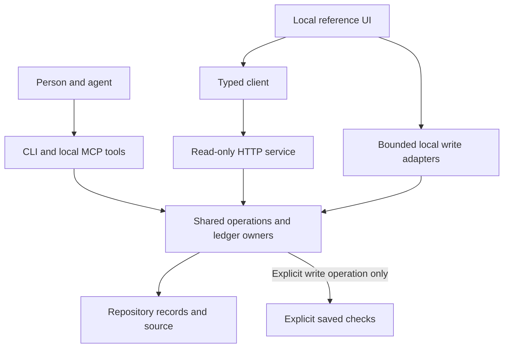

# Understand work and its evidence

Spec Ledger records planned work, permission, changes and evidence in a repository. It helps a person distinguish a reported implementation from a check that actually passed against the current files.

For example, an agent can report that a requirement is implemented while its test result is missing or stale. The work remains incomplete. A green claim report also does not automatically close a turn or complete a workstream: those operations check additional conditions.

| Goal                                    | Start here                                                                               |
| --------------------------------------- | ---------------------------------------------------------------------------------------- |
| Install and choose an interface         | [Setup](setup.md) and [transport boundaries](interfaces.md)                              |
| Understand whether a requirement passed | [Claims](claims.md) and [run evidence](checks.md)                                        |
| Start authorized work                   | [Permission](permission.md), [plans](plans.md), [turns](turns.md)                        |
| Review, correct and finish work         | [Reviews](reviews.md), [completion](completion.md), [deferred commitments](deferrals.md) |
| Reuse a method                          | [Workflows](workflows.md) and [saved workflow library](library.md)                       |
| Follow an agent or an experiment        | [Execution observations](execution.md), [experiments](experiments.md)                    |
| Find structure or previous decisions    | [Graph](graph.md), [context](context.md), [inventory](inventory.md)                      |
| Reproduce this atlas's checks           | [Verification](verification.md)                                                          |

The generic server only reads. The local UI has separate write adapters for specific actions; saying the entire UI is read-only would be wrong. Activity observations cannot resume an agent or cancel a process. Those boundaries matter when deciding what a displayed status proves.
