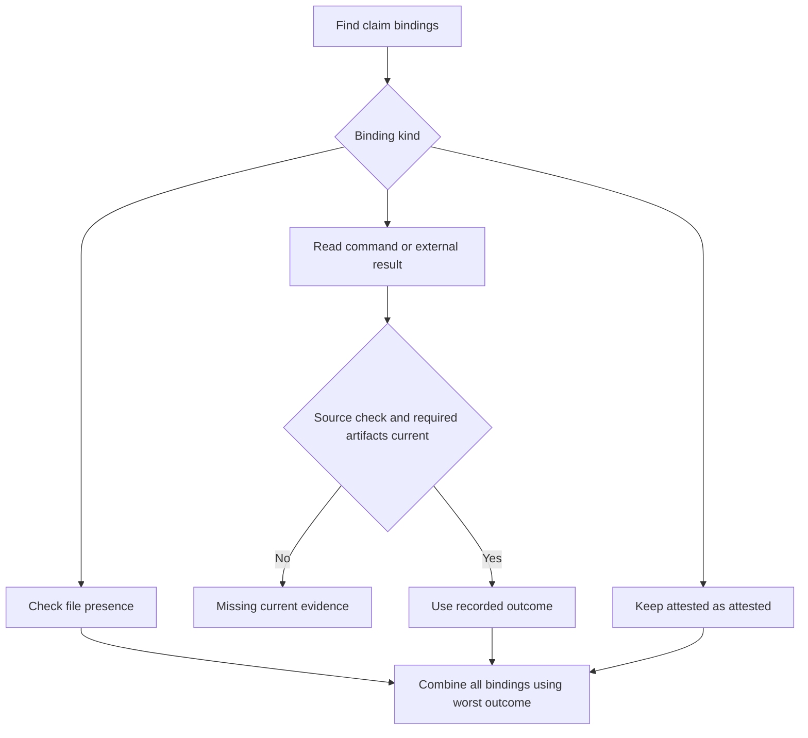

# Read a claim verdict

A claim states an expected behavior. A binding says how to inspect it; a result records what happened. Putting a passing status on a binding is not evidence that the behavior passed.

For example, a command result from yesterday can remain in history after today's source changes. Its source or check fingerprint no longer matches, so the current verdict becomes missing rather than continuing to show pass. A fingerprint is a hash of the relevant inputs, not a signature authenticating the person who supplied them.

## What can prevent a pass

Results-row and command bindings need matching source/check fingerprints. Required local artifacts must still exist and match their hashes. Duplicate result keys fail instead of choosing whichever row arrived last. Every binding contributes to the claim's worst outcome: fail outranks missing/unbound, then attested, then pass. Required claims cannot be satisfied by attestation. A path binding establishes file presence, not execution of its contents.

The report also checks graph endpoints and locator existence. `ok` means no report problems under those rules, not universal product correctness; an empty ledger can have no requirements checked. Deprecated claims are skipped. Optional claims can have nonpassing outcomes without automatically making the report fail.

The bounded EvidenceFreshness model isolates one passing results row, two source fingerprints and two check fingerprints, plus artifact validity. It models evaluation-time matching, not hashing, authenticity, duplicate-key handling or overall completion. Controls bypass each matching/artifact condition.

These models check finite safety only; completed states allow stuttering and terminal deadlock checks are disabled. No eventual progress is claimed.
