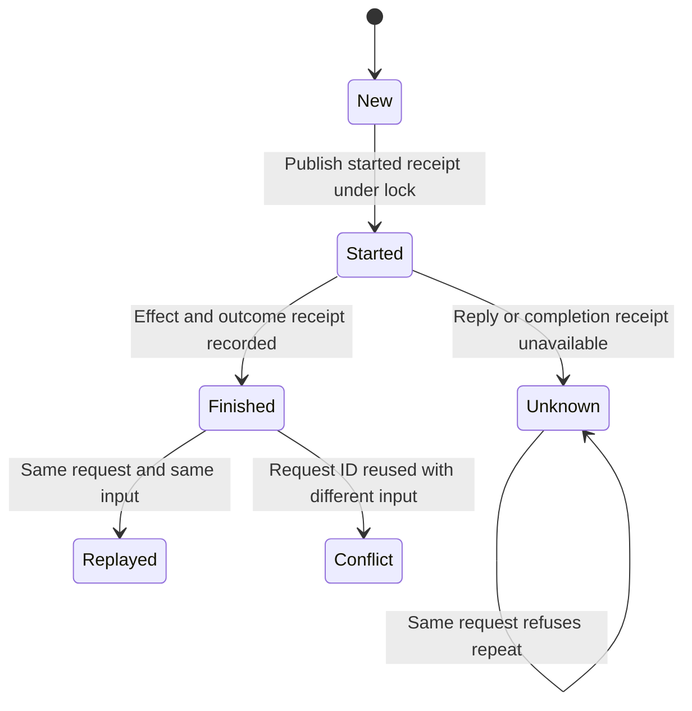

# Recover a lost mutation reply

CLI and MCP mutations use a shared operation request identity. Keep that identity and the original input when a reply is lost; a new ID is a new operation and can repeat effects.

## Unknown does not mean unchanged

The owner publishes the started receipt before invoking the effect. A matching finished receipt replays success or failure. A started receipt without a finished receipt returns execution_unknown instead of executing again. Inspect the intended record and operation evidence; do not change the request ID just to get past uncertainty.

Cooperative mutations take one cross-process lock and recheck the receipt after acquiring it. Busy means another owner holds the lock. Crash recovery is conservative: abandoned locks/unfinished records are not evidence that prior effects are absent. Direct edits or APIs outside that boundary are not serialized by it.

Receipts are immutable publications through temporary files and no-replace hard links. They are not a transaction rolling back arbitrary effect writes. An error after an effect may still leave that effect present. No generic automatic repair command is promised here.

The bounded MutationRetry model explores one request, effect execution and completion-receipt loss. It checks that matching retries do not execute again and changed input is not accepted as the original request. It abstracts lock/filesystem integrity and serialization; it does not prove every operation's effect is atomic.

These models check finite safety only; completed states allow stuttering and terminal deadlock checks are disabled. No eventual progress is claimed.
